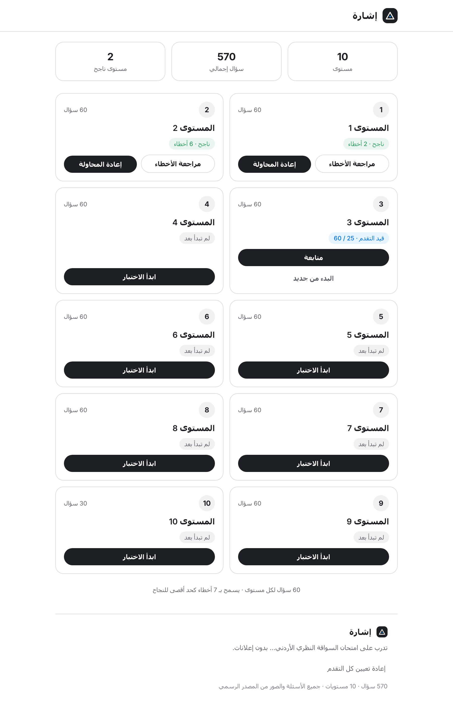
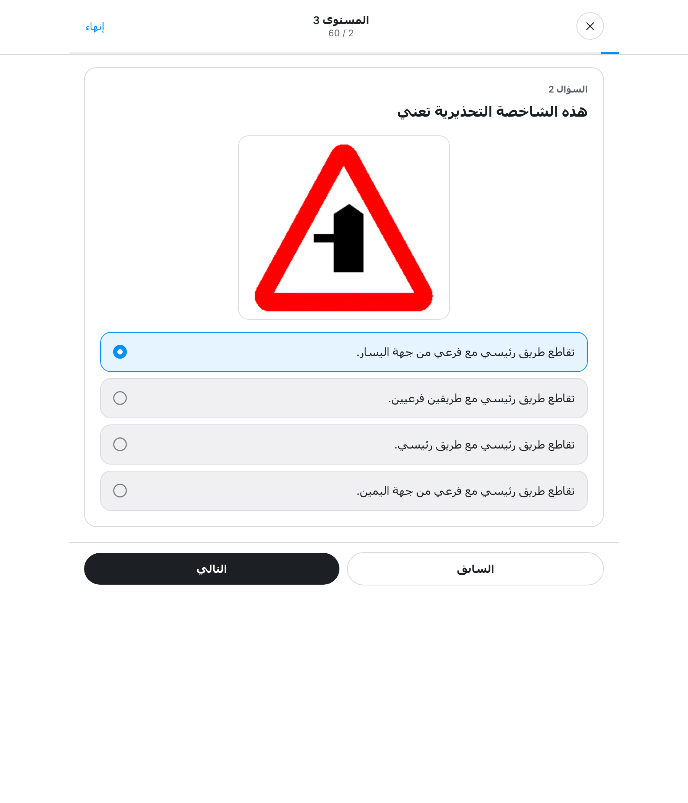
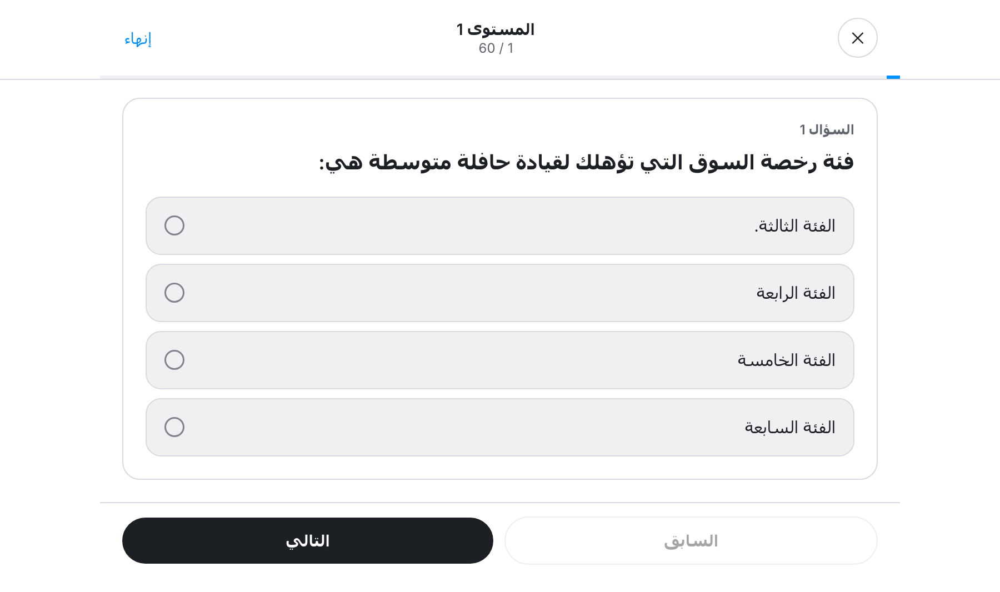
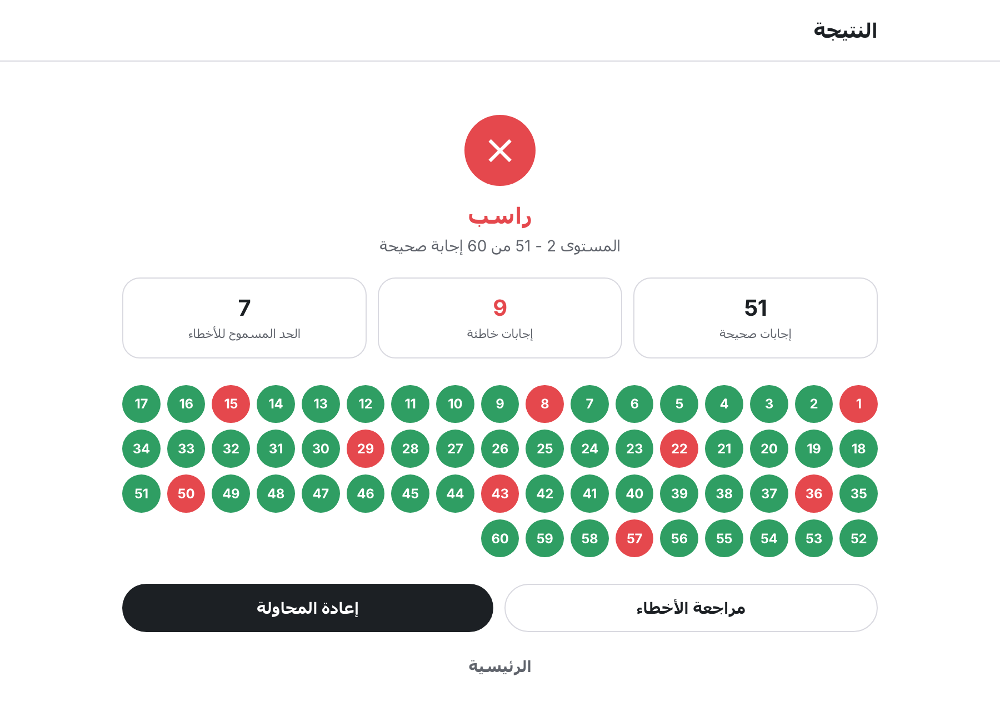
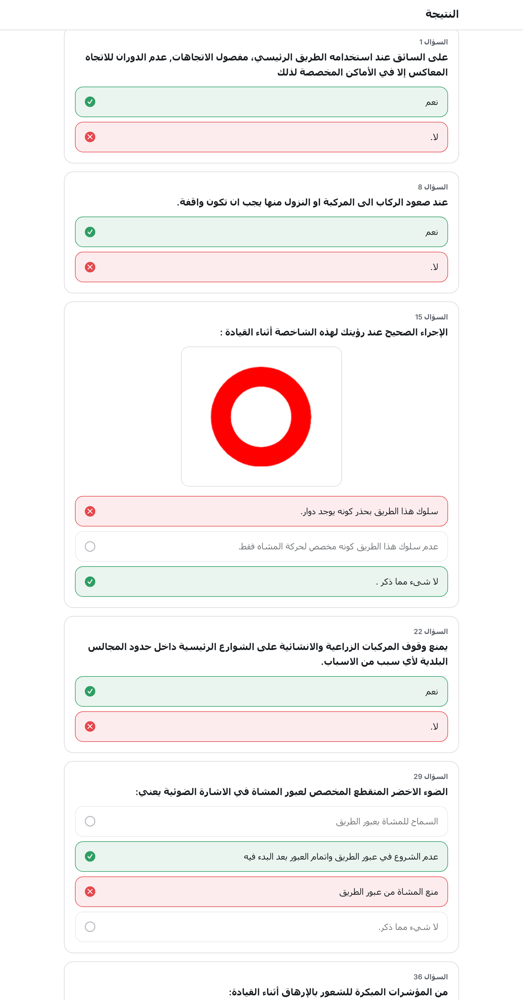

# إشارة (Ishara) — Jordan Driving Theory Exam Practice

A quiz website for practicing the Jordanian theoretical driving license exam. Built from a bank of **570 verified questions** (including road-sign images), split into **10 levels of 60 questions** to match the real exam format: 60 questions per attempt, up to **7 wrong answers** allowed — the exam stops immediately and marks you failed the moment an 8th wrong answer lands.

No build step, no backend, no ads — just static HTML, CSS, and JavaScript.

## Screenshots

### Home — levels overview
Tracks your last result and progress per level: pass/fail with wrong-answer count, or resume an in-progress attempt.



### Quiz — road-sign question
Road-sign questions show the actual sign image extracted from the source material.



### Quiz — text question
Plain questions render cleanly with no leftover image placeholder.



### Results
Nothing is revealed until you finish (or fail) — just like the real exam. Then you get a pass/fail verdict, your score, and a color-coded map of every question you reached.



### Review
Jump into any wrong answer to see exactly what you picked versus the correct answer.



## Features

- **10 levels, 60 questions each** (last level is a 30-question bonus round), matching the real exam's format
- **7 wrong answers allowed** — an 8th wrong answer ends the attempt immediately and marks it failed, mirroring how the real computerized exam cuts you off
- **Exam-realistic flow**: answers aren't revealed question-by-question, only once the attempt ends
- **Randomized question order** every attempt (answer choices stay in their original order)
- **Full results breakdown**: pass/fail, correct/wrong counts, and a per-question color grid
- **Answer review**: see your wrong answers next to the correct ones, with the original sign image where relevant
- **Progress saved automatically** (`localStorage`) — retake any level, resume an interrupted attempt, or review your last result anytime from the home screen

## Design

Visual identity: **إشارة** (*Ishara*, Arabic for "signal" / "sign") — named for the road signs the quiz tests you on, and for the one accent color the interface allows itself.

A near-monochrome interface (ink black on white, hairline borders, no shadows) with a single signal-blue accent reserved for interactive moments — your current selection, progress. Correct/wrong feedback in review uses green/red, since a quiz can't avoid that. Pill-shaped buttons and controls throughout, Inter typeface, RTL Arabic layout.

## Running it

Open [`index.html`](index.html) directly in a browser, or serve the folder as a static site (e.g. GitHub Pages). Everything — styles, script, question data, images — is a local file with one exception: the Inter typeface loads from Google Fonts, and falls back to the system font if there's no connection.

## Data

The question bank was extracted from four source Word documents (~150–160 questions each, with overlap between them). After parsing, de-duplicating, and dropping the handful of questions where the source never marked a clear correct answer, 570 unique verified questions remained:

|                                   |                                                            |
| --------------------------------- | ---------------------------------------------------------- |
| Total questions                   | 570                                                          |
| Levels                            | 10 (9 × 60 + 1 × 30)                                         |
| Questions with a road-sign image  | 282                                                          |
| Pass threshold                    | 7 wrong (scaled proportionally for the 30-question level), 8th wrong ends the attempt |

## Project structure

```
index.html          Single-page app (home / quiz / results screens)
css/style.css        Styling
js/data.js            Question bank, grouped into levels
js/app.js             App logic (quiz flow, scoring, localStorage persistence)
assets/images/        Road-sign images referenced by the question bank
screenshots/           Screenshots used in this README
```

## Tech

Vanilla HTML, CSS, and JavaScript. No frameworks, no dependencies, no build step.
